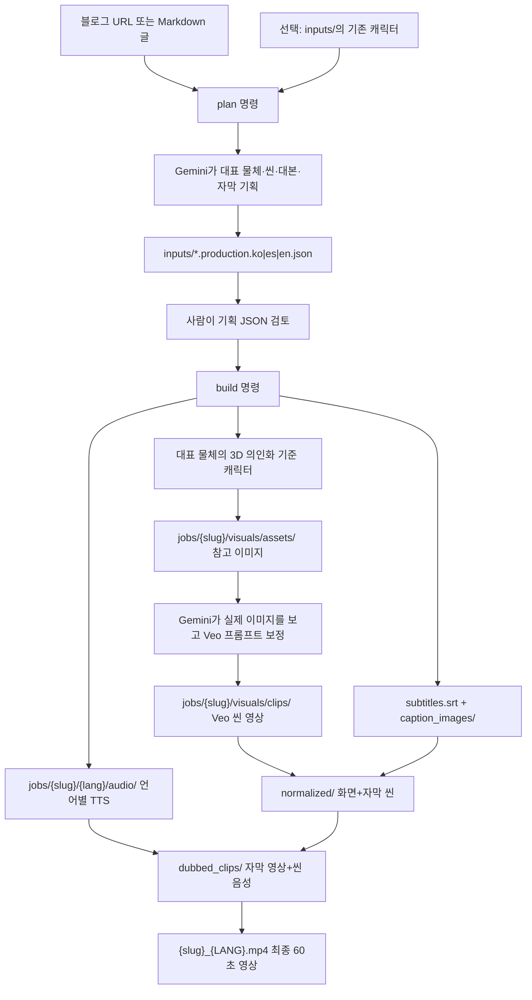

# FeverCoach Shorts 생성 가이드

이 문서는 블로그 글과 캐릭터 이미지를 입력해 60초 세로형 영상을 만드는 전체 흐름과, 각 파일·폴더의 역할을 설명한다.

기획·검수·수정 프롬프트는 [9월 13일 리뷰 가이드라인](REVIEW_GUIDELINES_2026-09-13.md)을 사용한다.
추가된 [Week 8 리뷰 가이드라인](REVIEW_GUIDELINES_2026-09-21.md)도 적용한다.
최신 [Jaeyoon FAIL 전용 보강 기준](REVIEW_GUIDELINES_2026-10-05.md)은 기획·이미지·Veo·검수·수정 프롬프트에 연결되어 있다.
씬 사이 진료 시점 충돌, 약별 재투여·농도, 월령 예외, 안전 수면과 삼킴을 검사한다.
필수 안전 문장이 기존 길이에 들어가지 않으면 씬 구성을 다시 검토하며, 의미를 삭제해 길이를 맞추지 않는다.

## 1. 한눈에 보는 전체 흐름



중요한 원칙은 **한국어·스페인어·영어가 같은 이미지와 Veo 영상을 공유**하고, 대본·음성·자막만 언어별로 따로 생성한다는 점이다.

## 2. 처음 한 번 준비하기

프로젝트 루트에서 실행한다.

```bash
cd /Users/jaeyoonlee/FeverCoach
python3 -m venv .venv
source .venv/bin/activate
python3 -m pip install -e .
brew install ffmpeg
cp .env.example .env
```

`.env`에서 최소한 아래 키를 설정한다.

```dotenv
GEMINI_API_KEY=실제_API_키
```

기본 생성 모델, 검수 설정, 작업 폴더는 `.env`에서 바꿀 수 있다. TTS 보이스는
모든 영상의 일관성을 위해 코드의 FeverCoach 프로필로 고정되어 있다.

| 항목 | 환경 변수 | 기본값/역할 |
|---|---|---|
| 글 분석·기획 모델 | `GEMINI_TEXT_MODEL` | 씬과 대본 기획 |
| 참고 이미지 모델 | `GEMINI_IMAGE_MODEL` | 씬별 9:16 이미지 생성 |
| 영상 모델 | `GEMINI_VIDEO_MODEL` | Veo 씬 영상 생성 |
| 예비 영상 모델 | `GEMINI_VIDEO_FALLBACK_MODEL` | 기본 Veo 재시도 실패 시 사용 |
| TTS 모델 | `GEMINI_TTS_MODEL` | 나레이션 생성 |
| TTS 보이스 | 코드의 고정 FeverCoach 프로필 | 항상 Gemini `Kore` |
| 최종 의료 검수 | `GEMINI_AUDIT_MODEL` | 기본 `gemini-2.5-flash` |
| 자동 수정 횟수 | `GEMINI_AUDIT_MAX_REPAIR_ROUNDS` | 기본 2회 |
| 자동 수정 최소 신뢰도 | `GEMINI_AUDIT_MIN_CONFIDENCE` | 기본 0.75 |
| 결과 루트 | `JOBS_DIR` | 기본 `jobs` |

## 3. 입력 파일 준비

`inputs/`의 캐릭터 이미지는 선택 사항이다. 직접 준비한 기존 캐릭터를
재사용하고 싶을 때만 넣는다.

```text
inputs/
└── my_character.png
```

이 폴더의 이미지는 **원본 입력 자산**이므로 계속 보관한다. 새 캐릭터를
자동으로 만들 때는 아예 이미지를 준비하지 않아도 된다.

원고는 다음 둘 중 하나를 사용한다.

- FeverCoach 블로그 URL
- 로컬 Markdown 원고 파일

## 4. 1단계: 기획 JSON 만들기

### 블로그 URL로 생성

```bash
source .venv/bin/activate

fevercoach-shorts plan \
  --url "https://www.fevercoach.us/ko/post/..." \
  --output inputs/my_video.production.json
```

### Markdown 원고로 생성

```bash
fevercoach-shorts plan \
  --article-file inputs/my_article.md \
  --output inputs/my_video.production.json
```

기존 캐릭터를 쓸 때만 두 명령에
`--character-image inputs/my_character.png`를 추가한다. 생략하면 Gemini가 글에서
대표 물체를 선택하고 `metadata.character_concept`에 근거와 외형을 저장한다.

기본적으로 아래 세 개의 기획 파일이 만들어진다.

```text
inputs/
├── my_video.production.ko.json   # 한국어
├── my_video.production.es.json   # 스페인어
└── my_video.production.en.json   # 영어
```

한국어만 필요하면 다음처럼 언어를 제한한다.

```bash
fevercoach-shorts plan \
  --url "https://www.fevercoach.us/ko/post/..." \
  --output inputs/my_video.production.json \
  --languages ko
```

### 대본과 자막 원문은 어디에 있나?

언어별 `production.json`의 `scenes`에 들어 있다.

```json
{
  "scenes": [
    {
      "index": 1,
      "narration": "TTS가 읽을 실제 대본",
      "subtitle": "대본과 같은 자막 원문",
      "caption_chunks": ["화면에 먼저 보일 조각", "다음에 보일 조각"]
    }
  ]
}
```

- `narration`: TTS가 읽는 실제 대본
- `subtitle`: 대본과 동일하게 유지되는 자막
- `caption_chunks`: 같은 문장을 1~3개의 짧은 화면 자막으로 나눈 것

`caption_chunks`가 대본의 단어를 누락하거나 바꾸면, 로더가 대본 전체를 기준으로 자막을 자동 복구한다.

## 5. 2단계: 비용 발생 전 기획 검증

```bash
fevercoach-shorts build \
  --config \
    inputs/my_video.production.ko.json \
    inputs/my_video.production.es.json \
    inputs/my_video.production.en.json \
  --plan-only
```

이 명령은 실제 이미지·영상·TTS를 생성하지 않고 다음을 검증한다.

- 총 재생 시간이 정확히 60초인지
- 씬 번호가 순서대로인지
- 이미지 경로와 씬 모드가 유효한지
- 대본에 차단된 위험 문구가 없는지
- 마지막 씬에 의료진 상담 권고가 있는지

생성되는 검토용 파일:

```text
jobs/{slug}/
├── visuals/generation_plan.json
├── ko/production.snapshot.json
├── es/production.snapshot.json
└── en/production.snapshot.json
```

## 6. 3단계: 실제 영상 생성

```bash
fevercoach-shorts build \
  --config \
    inputs/my_video.production.ko.json \
    inputs/my_video.production.es.json \
    inputs/my_video.production.en.json \
  --tts-provider gemini
```

ElevenLabs TTS를 사용할 때:

```bash
fevercoach-shorts build \
  --config inputs/my_video.production.ko.json \
  --tts-provider elevenlabs
```

참고 이미지와 Veo 씬 영상만 만들고 멈추려면:

```bash
fevercoach-shorts build \
  --config inputs/my_video.production.ko.json \
  --clips-only
```

진행 상태를 확인하려면:

```bash
fevercoach-shorts status \
  --config inputs/my_video.production.ko.json
```

## 7. 생성 결과는 어디에 저장되나?

`{slug}`는 기획 JSON의 최상위 `slug` 값이다. `{lang}`은 `ko`, `es`, `en` 중 하나다.

```text
jobs/{slug}/
├── visuals/                         # 세 언어가 공유하는 화면 자산
│   ├── character/
│   │   ├── reference.png             # 대표 물체의 3D 의인화 기준 캐릭터
│   │   └── manifest.json              # 캐릭터 프롬프트·캐시 정보
│   ├── generation_plan.json          # Veo에 보낼 전체 씬 계획
│   ├── refined_prompts.json          # 실제 이미지를 보고 보정한 Veo 프롬프트
│   ├── operations.json               # Veo 작업 ID·성공·재시도 상태
│   ├── assets/
│   │   ├── manifest.json             # 참고 이미지 캐시 정보
│   │   ├── scene_01.png              # 1번 씬 참고 이미지
│   │   └── scene_10.png              # 10번 씬 참고 이미지
│   └── clips/
│       ├── scene_01.mp4              # Veo가 만든 1번 씬 원본 영상
│       └── scene_10.mp4              # Veo가 만든 10번 씬 원본 영상
│
└── {lang}/                          # 언어별 출력: ko, es, en에 각각 생성
    ├── production.snapshot.json       # 빌드에 실제 사용한 기획 스냅샷
    ├── audio/
    │   ├── raw/                       # 씬별 TTS 원본 MP3/WAV
    │   ├── aligned/                   # 각 씬 길이에 맞춘 TTS MP3
    │   ├── manifest.json              # TTS 캐시·속도 조정 정보
    │   ├── concat.txt                 # 음성 합치기 목록
    │   └── voice_timeline.mp3         # 60초 전체 나레이션
    ├── subtitles.srt                 # 씬 단위 외부 자막 파일
    ├── caption_images/               # 영상에 입힐 투명 PNG 자막
    │   ├── scene_01_chunk_01.png
    │   └── scene_10_chunk_02.png
    ├── normalized/                   # 1080x1920, 자막을 입힌 무음성 씬
    │   ├── scene_01.mp4
    │   └── scene_10.mp4
    ├── dubbed_clips/                 # 자막 영상에 씬별 TTS를 붙인 영상
    │   ├── scene_01.mp4
    │   └── scene_10.mp4
    ├── silent.mp4                    # normalized 씬을 합친 무음성 60초 영상
    ├── video_concat.txt              # 무음성 씬 합치기 목록
    ├── dubbed_concat.txt             # 음성 있는 씬 합치기 목록
    ├── render_manifest.json           # 최종 렌더 정보
    └── {slug}_{LANG}.mp4             # 최종 완성본
```

### 가장 자주 찾을 파일

| 찾는 내용 | 저장 위치 |
|---|---|
| 원본 입력 캐릭터 | `inputs/<character>.png` |
| 편집할 대본·자막 원문 | `inputs/<name>.production.<lang>.json` |
| 자동 선정된 대표 물체 | 제작 JSON의 `metadata.character_concept` |
| 자동 생성된 기준 캐릭터 | `jobs/{slug}/visuals/character/reference.png` |
| 실제 빌드에 사용된 대본 | `jobs/{slug}/{lang}/production.snapshot.json` |
| 생성된 씬별 참고 이미지 | `jobs/{slug}/visuals/assets/scene_XX.png` |
| Veo 원본 씬 영상 | `jobs/{slug}/visuals/clips/scene_XX.mp4` |
| 이미지 분석 후 보정된 Veo 프롬프트 | `jobs/{slug}/visuals/refined_prompts.json` |
| TTS 음성 원본 | `jobs/{slug}/{lang}/audio/raw/scene_XX.mp3` |
| 길이를 맞춘 씬별 음성 | `jobs/{slug}/{lang}/audio/aligned/scene_XX.mp3` |
| 외부 자막 | `jobs/{slug}/{lang}/subtitles.srt` |
| 영상에 입히는 자막 이미지 | `jobs/{slug}/{lang}/caption_images/*.png` |
| 자막이 입혀진 씬별 영상 | `jobs/{slug}/{lang}/normalized/scene_XX.mp4` |
| 자막·음성이 모두 붙은 씬별 영상 | `jobs/{slug}/{lang}/dubbed_clips/scene_XX.mp4` |
| 업로드할 최종 완성본 | `jobs/{slug}/{lang}/{slug}_{LANG}.mp4` |

> 예전 단일 언어 설정 JSON은 `visuals/` 및 `{lang}/` 계층 없이 `jobs/{slug}/` 아래에 바로 저장될 수 있다. 현재 `plan` 명령으로 만든 다국어 기획은 위 표의 구조를 사용한다.

## 8. 고급 의료 영상 연출 프롬프트

건축 3D 설명 영상의 장점인 문제-해결 서사, 공간적 깊이, 두 단계 카메라
비트, 명확한 페이오프 화면을 소아 의료 정보에 맞게 변환한다.

씬 서사는 다음 순서를 사용한다.

```text
훅 → 임상 맥락 → 흔한 오해/질문 → 기전 공개 → 근거/임계값
→ 판단 → 재평가 → 안전한 행동 → 경고 신호 → 핵심 요약/상담
```

각 6초 씬은 `shot_design`으로 연출을 구조화한다.

| 항목 | 역할 |
|---|---|
| `camera_profile` | 비교, 단면, POV, 부감, 히어로 샷 등 씬의 주 카메라 문법 |
| `beat_one` | 0.0~1.5초: 전경을 통과하며 공간과 문제를 공개 |
| `beat_two` | 1.5~4.5초: 의학적 핵심 대상으로 카메라와 동작을 수렴 |
| `payoff_frame` | 4.5~6.0초: 시청자가 정보를 읽을 수 있게 멈춘 화면 |
| `depth_layers` | 전경·중경·배경 분리와 파랄랙스 깊이 |
| `overlay_safe_zone` | 코드가 나중에 숫자·계측선을 그릴 빈 영역 |
| `sound_cues` | 호흡, 기구, 유체 등 장면에 맞는 효과음 설계 |
| `transition_out` | 다음 씬으로 시선을 연결하는 마지막 방향 |

실제 참고 이미지가 만들면 Gemini가 화면에 **실제로 보이는 대상만** 다시
분석한다. 그 결과로 `SUBJECT`, `STYLE`, `COMPOSITION AND DEPTH`, `CAMERA BEAT
ONE`, `CAMERA BEAT TWO`, `PAYOFF HOLD`, `MEDICAL CLARITY`, `OVERLAY COMPOSITION`,
`COLOR RULE`, `SOUND`, `STRICT EXCLUSIONS`가 있는 고밀도 Veo 프롬프트를 코드가
일관된 형식으로 조립한다.

신뢰성을 위해 다음은 분리한다.

- Gemini 이미지/Veo: 한국어, 숫자, 단위, 화살표, 계측선을 생성하지 않음
- Python 오버레이: 정확한 문구, 수치, 단위, 빨간 계측선을 결정적으로 렌더링
- `refined_prompts.json`: 씬별 `medical_ambiguity`, `camera_occlusion`,
  `character_drift`, `overlay_collision`, `unsupported_object` 위험과 심각도 저장
- 기획 검증: 인접 씬의 카메라 프로파일 반복, 촬영 설계 누락, 캐릭터 과다/부족 사용 차단

## 9. 자막 생성 방식

자막은 두 가지 형태로 생성된다.

1. `subtitles.srt`: 외부 자막 파일
2. `caption_images/*.png`: 영상에 직접 합성하는 투명 자막 레이어

현재 영상에 입혀지는 자막 스타일은 다음과 같다.

- 화면 높이의 약 64% 지점: 중앙보다 조금 아래
- 흰색 굵은 글씨
- 검은 외곽선
- 배경 박스 없음
- 최대 2줄
- 문장 길이에 따라 36~64px 사이에서 크기 자동 조절
- 자막 조각의 글자 수에 비례해 씬 안의 표시 시간 배분

## 10. 폴더별 역할

| 폴더 | 역할 | 삭제 가능 여부 |
|---|---|---|
| `.venv/` | Python 가상환경과 설치된 패키지 | 삭제 시 재설치 필요 |
| `inputs/` | 캐릭터 원본, 원고, 검토·수정할 제작 JSON | 원본이므로 보존 권장 |
| `jobs/` | API와 FFmpeg가 만든 중간 결과·캐시·최종 영상 | 삭제 가능, 다음 빌드에서 재생성·비용 발생 |
| `audits/` | 완성 영상의 Gemini 감사 결과·프롬프트·로컬 검사 | 필요 없으면 삭제 가능 |
| `examples/` | 제작 JSON 예제 | 보존 권장 |
| `scripts/` | 여러 블로그 일괄 기획·빌드·감사 스크립트 | 코드이므로 보존 |
| `src/fevercoach_shorts/` | 파이프라인 본체 코드 | 코드이므로 보존 |
| `tests/` | 자막·TTS·안전성·Veo 재시도 자동 테스트 | 코드이므로 보존 |

## 11. 코드 파일별 역할

| 파일 | 하는 일 |
|---|---|
| `src/fevercoach_shorts/__main__.py` | `python -m fevercoach_shorts` 실행 진입점 |
| `src/fevercoach_shorts/cli.py` | `plan`, `build`, `status` 명령과 옵션 처리 |
| `src/fevercoach_shorts/settings.py` | `.env` 로드 및 Gemini·Veo·TTS·출력 설정 |
| `src/fevercoach_shorts/article.py` | URL에서 블로그 본문을 가져오거나 Markdown 원고 로드 |
| `src/fevercoach_shorts/planner.py` | Gemini에게 글과 캐릭터를 보내 씬·대본·자막·영상 프롬프트 기획 |
| `src/fevercoach_shorts/models.py` | `ProductionSpec`, `SceneSpec` 로드·저장·검증, 대본과 자막 일치 보장 |
| `src/fevercoach_shorts/safety.py` | 위험하거나 단정적인 의료 문구 차단, 마지막 상담 권고 확인 |
| `src/fevercoach_shorts/pipeline.py` | 이미지 → Veo → TTS → 자막 → 최종 렌더 순서를 조정하는 총괄 |
| `src/fevercoach_shorts/providers/assets.py` | 씬별 9:16 참고 이미지 생성·캐시 |
| `src/fevercoach_shorts/providers/character.py` | 글에서 선정한 대표 물체의 3D 의인화 기준 캐릭터 생성·캐시 |
| `src/fevercoach_shorts/providers/prompt_refiner.py` | 실제 씬 이미지와 기준 캐릭터를 Gemini로 분석해 Veo 프롬프트 보정 |
| `src/fevercoach_shorts/providers/veo.py` | Veo 씬 영상 요청·폴링·재시도·다운로드·상태 저장 |
| `src/fevercoach_shorts/providers/tts.py` | Gemini/ElevenLabs TTS 생성, 씬 길이에 맞게 속도·무음 조정, 전체 음성 합치기 |
| `src/fevercoach_shorts/subtitles.py` | 씬 타임라인에 맞춘 `subtitles.srt` 생성 |
| `src/fevercoach_shorts/captions.py` | 흰색 굵은 글씨·검은 외곽선의 투명 PNG 자막과 수치 오버레이 렌더 |
| `src/fevercoach_shorts/renderer.py` | FFmpeg로 비율·길이 정규화, 자막·TTS 합성, 씬 연결, `{slug}_{LANG}.mp4` 생성 |
| `scripts/plan_blog_batch.py` | 매니페스트의 여러 블로그를 언어별로 일괄 기획 |
| `scripts/build_blog_batch.py` | 여러 블로그·언어 제작 JSON을 순서대로 일괄 빌드 |
| `scripts/audit_blog_videos_with_gemini.py` | 완성 영상의 의료 정확성·원문 충실도·음성·자막·화면 감사 |

## 12. 여러 블로그를 한번에 처리하기

배치 매니페스 예시:

```json
{
  "character_image": "inputs/my_character.png",
  "languages": ["ko", "es", "en"],
  "posts": [
    {
      "key": "my-first-video",
      "url": "https://www.fevercoach.us/ko/post/..."
    }
  ]
}
```

일괄 기획:

```bash
.venv/bin/python scripts/plan_blog_batch.py \
  inputs/my_batch.json \
  --output-dir inputs/my_batch
```

일괄 영상 생성:

```bash
.venv/bin/python scripts/build_blog_batch.py \
  inputs/my_batch.json \
  --config-dir inputs/my_batch \
  --tts-provider gemini
```

## 13. 재실행과 캐시

같은 명령을 다시 실행하면 변경되지 않은 결과를 가능한 범위에서 재사용한다.

- 이미지 프롬프트·캐릭터·모델이 같으면 참고 이미지 재사용
- Veo 프롬프트·이미지·모델이 같으면 씬 영상 재사용
- 대본·보이스·TTS 모델이 같으면 음성 재사용
- 자막이 바뀌면 해당 자막 이미지와 렌더 결과 재생성

생성 결과를 지운 뒤 영상을 완전히 새로 만들려면 `operations.json`도 함께 초기화되어야 한다. 이 파일이 없으면 다음 `build`가 Veo 씬을 새로 요청한다.

## 14. 실행 전·후 체크리스트

실행 전:

- `.env`에 `GEMINI_API_KEY`가 있는지
- `inputs/`의 캐릭터 이미지 경로가 맞는지
- 대본과 자막에 의료적 오류가 없는지
- 각 씬 시간의 합이 60초인지
- 실제 API 비용 전 `--plan-only`를 통과했는지

실행 후:

- `visuals/assets/`의 이미지에 글자·워터마크·잘못된 의료 표현이 없는지
- `visuals/clips/`의 각 씬이 프롬프트와 맞는지
- `audio/aligned/`의 음성이 끊기거나 과도하게 빠르지 않은지
- `caption_images/`의 자막 문구·줄바꿈·위치가 올바른지
- `{slug}_{LANG}.mp4`의 길이가 60초이고 영상·음성·자막이 일치하는지
- 게시 전 의료진이 최종 내용을 검수했는지
